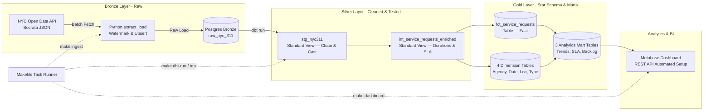

# NYC 311 Data Platform

An end-to-end data platform that ingests live municipal service request data from the NYC 311 Open Data API, transforms it through a Medallion Architecture (Bronze → Silver → Gold) using PostgreSQL and dbt, and visualizes analytical insights in an automated Metabase dashboard.
There is **no scheduler or orchestrator** — every step is run manually via a `Makefile` task runner.


*Metabase dashboard automatically provisioned by `make dashboard` from `gold.*` tables.*

---

## Architecture & Data Lineage

The platform follows a three-tier **Medallion Architecture**, run via a `Makefile` task runner (there is no automated scheduler):



**Layer Materialization (configured in [`dbt/dbt_project.yml`](dbt/dbt_project.yml)):**

| Layer | dbt Folder | Materialization | PostgreSQL Schema | Description |
|---|---|---|---|---|
| **Bronze** | *(Python ingestion)* | Table | `bronze` | Raw data landed in `bronze.raw_nyc_311` with audit metadata (`_ingested_at`, `_source_batch_id`) and high-watermark upserts (`ON CONFLICT DO UPDATE`). |
| **Silver** | `models/staging/` | **View** | `silver` | Standard SQL views that cast text fields, standardize complaint strings, and validate borough values. |
| **Silver** | `models/intermediate/` | **View** | `silver` | Standard SQL views calculating resolution hours, SLA breach flags, and dimension surrogate keys. |
| **Gold** | `models/marts/` | **Table** | `gold` | Physical tables modeled as a dimensional **Star Schema** (fact + 4 dimensions) and 3 analytical marts. |
| **Serving** | `dashboard/` | BI App | Metabase | Containerized BI dashboard automatically provisioned via Metabase REST API. |

---

## Business Questions Answered

| # | Business Question | Answering Mart / Model | Key Metric |
|---|---|---|---|
| **Q1** | Which complaint types are most common across NYC? | `gold.mart_complaint_trends` | Total request count & monthly rank |
| **Q2** | Which complaint categories are accelerating over time? | `gold.mart_complaint_trends` | Month-over-Month (% MoM) growth rate |
| **Q3** | How quickly do city agencies resolve tickets, and what is their SLA breach rate? | `gold.mart_agency_resolution` | Median and P90 resolution hours, SLA breach % |
| **Q4** | How many requests remain unresolved, and what is their average age? | `gold.mart_open_backlog` | Open request count, average days open by borough |

---

## Results

### Pipeline Execution Metrics

The figures below were measured by executing the complete pipeline against the local PostgreSQL warehouse:

| Metric | Measured Value | Notes |
|---|---|---|
| **Bronze Records Ingested** | `315,111` rows | Stored in `bronze.raw_nyc_311` |
| **Date Range Covered** | `2026-10-12 18:35:26` to `2026-11-10 01:58:59` | Initial 30-day window (`INGEST_LOOKBACK_DAYS=30`) |
| **`make ingest` Execution Time** | `~0.8s` (watermark check) / `~2.5s` (5k-batch fetch) | Network roundtrip dependent |
| **`make dbt-run` Execution Time** | `2.28s` (wall clock `4.85s`) | Builds 2 views and 8 physical tables (315,111 fact rows) |
| **`make dbt-test` Execution Time** | `0.67s` (wall clock `2.87s`) | 25 tests: **24 PASS, 1 WARN, 0 FAIL** |
| **dbt Test Warning Details** | 265 results in `assert_closed_not_before_created` | Expected dirty upstream records (`closed_at < created_at`), flagged with `has_invalid_close_date = TRUE` |

### Sample Mart Queries & Real Outputs

#### 1. Complaint Trends (`gold.mart_complaint_trends` — Q1 & Q2)
```sql
SELECT complaint_type, month_start, request_count, rank_in_month, prev_month_count, mom_change_pct
FROM gold.mart_complaint_trends
WHERE month_start = '2026-11-01'
ORDER BY rank_in_month ASC
LIMIT 3;
```
| complaint_type | month_start | request_count | rank_in_month | prev_month_count | mom_change_pct |
|---|---|---|---|---|---|
| Illegal Parking | 2026-11-01 | 17,009 | 1 | 37,859 | -55.1% |
| Noise - Residential | 2026-11-01 | 9,335 | 2 | 21,626 | -56.8% |
| HEAT/HOT WATER | 2026-11-01 | 7,336 | 3 | 21,636 | -66.1% |

#### 2. Agency Resolution Performance (`gold.mart_agency_resolution` — Q3)
```sql
SELECT agency, closed_month, closed_count, avg_resolution_hours, median_resolution_hours, p90_resolution_hours
FROM gold.mart_agency_resolution
WHERE closed_month = '2026-10-01'
ORDER BY closed_count DESC
LIMIT 3;
```
| agency | closed_month | closed_count | avg_resolution_hours | median_resolution_hours | p90_resolution_hours |
|---|---|---|---|---|---|
| NYPD | 2026-10-01 | 96,174 | 2.57 | 1.30 | 6.28 |
| HPD | 2026-10-01 | 32,667 | 86.98 | 60.98 | 203.06 |
| DSNY | 2026-10-01 | 14,622 | 47.31 | 33.16 | 102.72 |

#### 3. Open Request Backlog (`gold.mart_open_backlog` — Q4)
```sql
SELECT agency, borough, complaint_type, open_count, avg_days_open
FROM gold.mart_open_backlog
ORDER BY open_count DESC
LIMIT 3;
```
| agency | borough | complaint_type | open_count | avg_days_open |
|---|---|---|---|---|
| HPD | BRONX | HEAT/HOT WATER | 1,963 | 14.3 |
| HPD | BROOKLYN | UNSANITARY CONDITION | 1,959 | 13.1 |
| HPD | MANHATTAN | UNSANITARY CONDITION | 1,586 | 12.8 |

---

## Data Modeling (Star Schema)

The analytical Gold layer uses an accumulating snapshot Star Schema centered on service requests:

```text
                  dim_date (created & closed)
                            │
  dim_agency ─── fct_service_requests ─── dim_complaint_type
                            │
                       dim_location
```

* **Fact Table (`fct_service_requests`):**
  * **Grain:** One row per service request (`unique_key`).
  * **Keys:** MD5 surrogate keys linking to each dimension (`agency_key`, `date_key`, `location_key`, `complaint_type_key`).
  * **Measures & Flags:** `resolution_time_hours`, `is_closed`, `is_sla_breached`, `has_invalid_close_date`.
  * **Degenerate Dimensions:** `status`, `channel_type`, `resolution_description`.
* **Dimension Tables:**
  * [`dim_agency`](dbt/models/marts/dim_agency.sql): City agencies responding to requests (NYPD, HPD, DSNY, DOT, etc.).
  * [`dim_date`](dbt/models/marts/dim_date.sql): Calendar dimension (year, quarter, month, day of week, weekend flag) covering all request creation and closure dates.
  * [`dim_location`](dbt/models/marts/dim_location.sql): Borough and ZIP code combinations (nulls safely assigned to `UNSPECIFIED`).
  * [`dim_complaint_type`](dbt/models/marts/dim_complaint_type.sql): Granular complaint classification and descriptors.

---

## Tech Stack

* **Language & Runtime:** Python 3.12+
* **Data Warehouse:** PostgreSQL 18
* **Data Transformation & Testing:** dbt-core 1.11 (`dbt-postgres`)
* **Business Intelligence:** Metabase v0.63.22
* **Infrastructure:** Docker & Docker Compose
* **Developer CLI:** GNU Make

---

## Configuration Reference

All settings can be specified in a local `.env` file (copied from [`.env.example`](.env.example)). Default values are read from [`extract_load/config.py`](extract_load/config.py) and [`dashboard/setup_metabase.py`](dashboard/setup_metabase.py):

| Variable | Description | Default in Code | `.env.example` Default |
|---|---|---|---|
| `POSTGRES_HOST` | Hostname for the PostgreSQL database instance | `localhost` | `localhost` |
| `POSTGRES_PORT` | Port exposed by PostgreSQL container | `5432` | `5432` |
| `POSTGRES_USER` | PostgreSQL database user | `postgres` | `your_user` |
| `POSTGRES_PASSWORD` | PostgreSQL user password | `""` (empty) | `your_password` |
| `POSTGRES_DB` | Name of the warehouse database | `nyc311` | `nyc311` |
| `SOCRATA_ENDPOINT` | Socrata API JSON endpoint for NYC 311 service requests | `https://data.cityofnewyork.us/resource/erm2-nwe9.json` | `https://data.cityofnewyork.us/resource/erm2-nwe9.json` |
| `INGEST_BATCH_SIZE` | Pagination limit per Socrata API request | `5000` | `5000` |
| `INGEST_LOOKBACK_DAYS` | Lookback window in days when table is empty or `--full-refresh` is passed | `30` | `30` |
| `METABASE_PORT` | Local host port mapped to Metabase web service | `3000` | `3000` |
| `METABASE_ADMIN_EMAIL` | Admin email used to initialize Metabase on first run | *(Required in env)* | `admin@example.com` |
| `METABASE_ADMIN_PASSWORD` | Admin password used to initialize Metabase on first run | *(Required in env)* | `change_me_123` |

---

## Quickstart & How to Run

### Prerequisites
* Docker & Docker Compose
* Python 3.12+
* `make`

---

### Step 1: Set Up Python Environment

```bash
# Create and activate virtual environment
python3 -m venv .venv
source .venv/bin/activate

# Install dependencies (dbt, psycopg2, requests)
pip install -r requirements.txt
```

---

### Step 2: Configure Environment Variables

Copy the example configuration to `.env`:

```bash
cp .env.example .env
```

*(Edit `.env` if you need custom database credentials or ports).*

---

### Step 3: Start Services

Launch PostgreSQL 18 and Metabase in the background:

```bash
make docker-up
```

Verify that the database is healthy and reachable:

```bash
make dbt-debug
```

---

### Step 4: Ingest Raw Data (Bronze)

Fetch NYC 311 records from the Socrata API and upsert them into `bronze.raw_nyc_311`:

```bash
make ingest
```

* **Default Behavior:** By default, `make ingest` executes `python3 -m extract_load.main --max-records 5000`, fetching up to **5,000 records** in batches of 5,000 within an initial lookback window of **30 days** (`INGEST_LOOKBACK_DAYS=30`).
* **Customizing Ingestion Volume:**
  * **Fetch more/fewer records:** Run the Python CLI directly with `--max-records <N>`:
    ```bash
    python3 -m extract_load.main --max-records 50000
    ```
  * **Fetch all available records:** Omit `--max-records` to ingest all incremental records up to the API limit:
    ```bash
    python3 -m extract_load.main
    ```
  * **Change defaults:** Update `INGEST_BATCH_SIZE`, `INGEST_LOOKBACK_DAYS`, or `INGEST_MAX_RECORDS` in `.env` (managed in [`extract_load/config.py`](extract_load/config.py)).
  * **Force full lookback reload:** Pass `--full-refresh` to bypass the existing watermark timestamp.

---

### Step 5: Run Transformations & Tests (Silver & Gold)

Execute dbt models to build all views, dimensions, facts, and marts:

```bash
make dbt-run
```

Run automated data quality tests:

```bash
make dbt-test
```

---

### Step 6: Provision & View the Dashboard

Build the pre-configured **NYC 311 Service Requests** dashboard in Metabase:

```bash
make dashboard
```

Once the script finishes, open **[http://localhost:3000](http://localhost:3000)** in your browser:
* **Email:** `admin@example.com` (or your `METABASE_ADMIN_EMAIL`)
* **Password:** `change_me_123` (or your `METABASE_ADMIN_PASSWORD`)

---

### Step 7: Teardown

When finished, stop all containerized services:

```bash
make docker-down
```

*(To completely remove database and Metabase volumes, run `docker compose down -v`).*

---

## Data Quality & Testing

The project includes **25 automated data tests** validating schema contracts and referential integrity:
* **Primary Key Constraints:** `unique` and `not_null` verified on all dimension surrogate keys and fact `unique_key`.
* **Referential Integrity:** 5 foreign key `relationships` tests verifying that 100% of rows in `fct_service_requests` join cleanly to their respective dimensions.
* **Accepted Values:** Borough names strictly checked against the 5 valid NYC boroughs (`BRONX`, `BROOKLYN`, `MANHATTAN`, `QUEENS`, `STATEN ISLAND`).
* **Source Anomaly Detection:** A custom dbt test ([`assert_closed_not_before_created.sql`](dbt/tests/assert_closed_not_before_created.sql)) monitors upstream dirty records where tickets were marked closed before they were created, automatically flagging them with `has_invalid_close_date = TRUE` and warning without crashing the pipeline.

---

## Limitations & Future Work

### Current Limitations
* **No Automated Scheduling or Orchestration:** There is no workflow scheduler (Airflow, Dagster, or cron). All pipeline operations (`ingest`, `dbt-run`, `dbt-test`, `dashboard`) must be executed manually via `make` targets.
* **No Incremental dbt Materializations:** Gold tables and the fact table are rebuilt via full table replacement (`materialized: table`) during `make dbt-run`, rather than using `is_incremental()` logic. This requires full table rewrites as data volume expands.

### Future Work
* **Workflow Orchestration:** Integrate Dagster or Apache Airflow to orchestrate daily incremental ingestion, transformations, and automated alerting.
* **Incremental dbt Models:** Convert `fct_service_requests` to an incremental dbt model filtered by `_ingested_at` or `created_at` to minimize warehouse compute on large batches.
* **CI/CD Integration:** Set up GitHub Actions workflows to run `pytest`, `dbt parse`, SQL linting, and schema test checks on pull requests.
* **Data Freshness Monitoring:** Add dbt `source freshness` tests on `bronze.raw_nyc_311` to alert if new records have not been ingested within 24 hours.

---

## Project Structure

```text
├── dashboard/
│   └── setup_metabase.py          # Automated REST API provisioning for Metabase
├── dbt/
│   ├── dbt_project.yml            # dbt configuration (silver: views, gold: tables)
│   ├── profiles.yml               # PostgreSQL connection profile
│   ├── macros/
│   │   └── generate_schema_name.sql # Custom schema resolver (bronze/silver/gold)
│   ├── models/
│   │   ├── staging/               # Silver standard views: type casting & cleansing
│   │   ├── intermediate/          # Silver standard views: duration calculations & SLA flags
│   │   └── marts/                 # Gold physical tables: Star Schema fact, dims, and 3 marts
│   └── tests/                     # Custom data quality tests
├── docs/
│   ├── architecture.drawio        # draw.io diagram source file
│   └── images/
│       └── Metabase - NYC 311 Service Requests_page-0001.jpg # Metabase dashboard export
├── extract_load/
│   ├── client.py                  # Socrata API client with pagination
│   ├── db.py                      # PostgreSQL batch upsert loader
│   ├── config.py                  # Ingestion settings & environment parsing
│   └── main.py                    # Ingestion CLI entrypoint
├── infra/
│   └── postgres/
│       ├── 01_schemas.sql         # Auto-provision bronze, silver, gold schemas
│       └── 02_bronze_tables.sql   # Raw landing table DDL
├── tests/                         # Pytest unit tests for ingestion
├── docker-compose.yml             # PostgreSQL 18 & Metabase services
├── Makefile                       # Unified developer CLI task runner
├── requirements.txt               # Pinned Python dependencies
└── README.md
```
