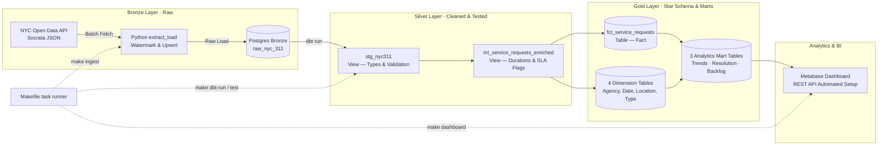

# NYC 311 Data Platform

An end-to-end data platform that ingests live municipal service-request data from the NYC 311 Open Data API, transforms it through a Medallion Architecture (Bronze → Silver → Gold) using PostgreSQL and dbt, and renders analytical insights in an automated Metabase dashboard.
There is **no scheduler or orchestrator** — every step is triggered manually via `make` targets.

<!-- TODO: replace with actual screenshot once docs/images/dashboard.png is generated -->

*Metabase dashboard provisioned automatically by `make dashboard` from `gold.*` tables.*

---

## Architecture & Data Lineage

The platform uses a three-tier **Medallion Architecture** with each step triggered manually through `make`:



**Layer materialization (from [`dbt_project.yml`](dbt/dbt_project.yml)):**

| Layer | dbt folder | Materialization | PostgreSQL schema |
|---|---|---|---|
| Bronze | *(ingested by Python)* | Table | `bronze` |
| Silver – staging | `models/staging/` | **View** | `silver` |
| Silver – intermediate | `models/intermediate/` | **View** | `silver` |
| Gold – dimensions / fact / marts | `models/marts/` | **Table** | `gold` |

---

## Business Questions Answered

| # | Business Question | Answering Model | Key Metric |
|---|---|---|---|
| **Q1** | Which complaint types are most common across NYC? | `gold.mart_complaint_trends` | Total request count & monthly rank |
| **Q2** | Which complaint categories are growing over time? | `gold.mart_complaint_trends` | Month-over-Month change % (`mom_change_pct`) |
| **Q3** | How quickly do city agencies resolve tickets? | `gold.mart_agency_resolution` | Median and P90 resolution hours; SLA breach % |
| **Q4** | How many requests remain unresolved, and how old are they? | `gold.mart_open_backlog` | Open count, average days open, by borough |

---

## Results

> All figures below were measured on a **local machine** running PostgreSQL 18 in Docker and dbt in a Python 3.12 virtualenv.

### Pipeline run metrics

| Step | Command | Wall time |
|---|---|---|
| Incremental ingest (0 new records — already up to date) | `make ingest` | ~1.7 s |
| Full dbt model run (10 models) | `make dbt-run` | ~4.8 s |
| All 25 data tests | `make dbt-test` | ~3.1 s |

### Bronze table

| Metric | Value |
|---|---|
| Total rows in `bronze.raw_nyc_311` | **315,111** |
| Earliest `created_date` | 2026-10-12 |
| Latest `created_date` | 2026-11-10 |
| Date range covered | ~29 days |

> On the **first run** (empty table) `make ingest` fetches all records created within the last `INGEST_LOOKBACK_DAYS` (default **30 days**) in pages of `INGEST_BATCH_SIZE` (default **5,000**). Subsequent runs fetch only records newer than the stored high-watermark.

### dbt model output

| Model | Type | Rows |
|---|---|---|
| `silver.stg_nyc311` | View | — |
| `silver.int_service_requests_enriched` | View | — |
| `gold.dim_agency` | Table | 14 |
| `gold.dim_date` | Table | 78 |
| `gold.dim_location` | Table | 258 |
| `gold.dim_complaint_type` | Table | 861 |
| `gold.fct_service_requests` | Table | 315,111 |
| `gold.mart_agency_resolution` | Table | 26 |
| `gold.mart_complaint_trends` | Table | 328 |
| `gold.mart_open_backlog` | Table | 562 |

### dbt test results

```
Done. PASS=24  WARN=1  ERROR=0  SKIP=0  TOTAL=25
```

The single warning is `assert_closed_not_before_created`: **265 source records** have `closed_date < created_date` — a known upstream data-quality issue in the NYC Open Data feed. These records are flagged with `has_invalid_close_date = TRUE` in `fct_service_requests` and are excluded from all resolution-time calculations; they are displayed as a separate KPI in the dashboard.

### Sample mart queries

**`gold.mart_complaint_trends` — Top 5 complaint types, October 2026**

| complaint_type | month | requests | rank |
|---|---|---|---|
| Illegal Parking | 2026-10 | 37,859 | #1 |
| HEAT/HOT WATER | 2026-10 | 21,636 | #2 |
| Noise - Residential | 2026-10 | 21,626 | #3 |
| Blocked Driveway | 2026-10 | 11,014 | #4 |
| Noise - Street/Sidewalk | 2026-10 | 9,773 | #5 |

> `mom_change_pct` is `NULL` for October 2026 because there are no September 2026 records in the current dataset — the ingestion window starts 2026-10-12.

**`gold.mart_agency_resolution` — Top 5 agencies by closed tickets, October 2026**

| agency | closed | avg hrs | median hrs | p90 hrs | sla_breach_pct |
|---|---|---|---|---|---|
| NYPD | 96,174 | 2.57 | 1.30 | 6.28 | NULL* |
| HPD | 32,667 | 86.98 | 60.98 | 203.06 | NULL* |
| DSNY | 14,622 | 47.31 | 33.16 | 102.72 | 0.0 % |
| DEP | 9,067 | 49.21 | 21.80 | 144.35 | NULL* |
| DOT | 8,989 | 75.79 | 29.86 | 239.07 | NULL* |

*`sla_breach_pct` is `NULL` for most agencies because `due_date` is populated on fewer than 1 % of records in the source dataset — only DSNY tickets carried a due date in this window.*

**`gold.mart_open_backlog` — 5 largest open backlogs**

| agency | complaint_type | borough | open | avg age |
|---|---|---|---|---|
| HPD | HEAT/HOT WATER | BRONX | 1,963 | 14.3 days |
| HPD | UNSANITARY CONDITION | BROOKLYN | 1,959 | 13.1 days |
| HPD | UNSANITARY CONDITION | MANHATTAN | 1,586 | 12.8 days |
| HPD | UNSANITARY CONDITION | BRONX | 1,358 | 9.9 days |
| HPD | HEAT/HOT WATER | BROOKLYN | 1,116 | 12.2 days |

---

## Data Modeling — Star Schema

```text
                  dim_date (created & closed)
                            │
  dim_agency ─── fct_service_requests ─── dim_complaint_type
                            │
                       dim_location
```

**Fact table** `fct_service_requests` — grain: one row per service request (`unique_key`):
* **Surrogate keys:** MD5 of natural key(s) — stable across full rebuilds.
* **Measures:** `resolution_time_hours`, `is_sla_breached`, `is_closed`, `has_invalid_close_date`.
* **Degenerate dimensions** kept on the fact: `status`, `channel_type`, `resolution_description` (low cardinality; not worth separate dimension tables).

**Dimension tables:**

| Table | Key | Rows | Contents |
|---|---|---|---|
| `dim_agency` | `agency_key` | 14 | Agency acronym + full name |
| `dim_date` | `date_key` (YYYYMMDD) | 78 | Year, quarter, month, day-of-week, weekend flag |
| `dim_location` | `location_key` | 258 | Borough + ZIP code; NULLs mapped to `UNSPECIFIED` |
| `dim_complaint_type` | `complaint_type_key` | 861 | Complaint type + descriptor |

---

## Key Engineering Decisions & Trade-offs

| Decision | Why Chosen | What Was Avoided |
|---|---|---|
| **NYC 311 Dataset** | Real volume, daily API updates, dirty real-world fields (missing dates, inconsistent boroughs) | Clean or synthetic toy CSVs with no real data-quality challenges |
| **Medallion Layers** | Bronze is preserved raw; transforms replay from source without re-hitting the API | Single-layer ETL directly into reporting tables — no audit trail, no replay |
| **Docker for DB & BI** | One-command identical dev environment for PostgreSQL 18 + Metabase | Manual local installs that drift between developer machines |
| **Local dbt (virtualenv)** | Instant feedback loop — `dbt run`, `dbt test`, IDE linting — no container rebuild overhead | Containerising dbt adds volume-mount complexity with no benefit at this scale |
| **Watermark upsert** | Incremental fetch since last `max(created_date)` + `ON CONFLICT DO UPDATE` = safe re-runs | Full truncate-and-reload causes downtime; append-only creates duplicates |
| **Silver as views** | View DDL updates propagate instantly; no storage duplicated for intermediate steps | Materialising staging/intermediate as tables wastes I/O for data that is rebuilt on every run anyway |

---

## Tech Stack

| Tool | Version | Role |
|---|---|---|
| Python | 3.12 | Ingestion pipeline (`extract_load/`) |
| PostgreSQL | 18 (Docker) | Storage for all three layers |
| dbt-postgres | 1.11.0 | Transformation, testing, schema management |
| Metabase | v0.63.22 (Docker) | BI dashboard (auto-provisioned) |
| Docker Compose | — | Service orchestration (Postgres + Metabase) |
| GNU Make | — | Developer task runner |

---

## Configuration

Every variable read from `.env.example` / `extract_load/config.py`:

| Variable | Default | Purpose |
|---|---|---|
| `POSTGRES_HOST` | `localhost` | PostgreSQL host (use `postgres` inside Docker) |
| `POSTGRES_PORT` | `5432` | PostgreSQL port |
| `POSTGRES_USER` | `your_user` | Database user |
| `POSTGRES_PASSWORD` | `your_password` | Database password |
| `POSTGRES_DB` | `nyc311` | Database name |
| `SOCRATA_ENDPOINT` | `https://data.cityofnewyork.us/resource/erm2-nwe9.json` | NYC 311 Socrata SODA API URL |
| `INGEST_BATCH_SIZE` | `5000` | Records per API page (also set via `--batch-size`) |
| `INGEST_LOOKBACK_DAYS` | `30` | Days to look back on the **first** run when Bronze is empty |
| `INGEST_MAX_RECORDS` | *(unset = unlimited)* | Hard cap on total records per run (also set via `--max-records`) |
| `METABASE_PORT` | `3000` | Host port Metabase binds to |
| `METABASE_ADMIN_EMAIL` | `admin@example.com` | Metabase admin account email |
| `METABASE_ADMIN_PASSWORD` | `change_me_123` | Metabase admin account password *(change before sharing)* |

> `SOCRATA_TIMEOUT`, `SOCRATA_MAX_RETRIES`, and `SOCRATA_BACKOFF_FACTOR` can also be set; see [`extract_load/config.py`](extract_load/config.py) for defaults (30 s, 4 retries, factor 1.0).

---

## Quickstart

### Prerequisites
* Docker & Docker Compose
* Python 3.12+
* `make`

> **Windows users:** use Git Bash or WSL so `make` commands run identically.

---

### Step 1 — Python environment

```bash
python3 -m venv .venv
source .venv/bin/activate        # Windows: .venv\Scripts\activate
pip install -r requirements.txt
```

---

### Step 2 — Environment variables

```bash
cp .env.example .env
# Edit .env to set POSTGRES_USER, POSTGRES_PASSWORD, and METABASE_ADMIN_PASSWORD
```

---

### Step 3 — Start services

```bash
make docker-up      # starts postgres:18 and metabase:v0.63.22
make dbt-debug      # verify dbt can connect to PostgreSQL
```

---

### Step 4 — Ingest raw data (Bronze)

```bash
make ingest
```

**Default behaviour on first run:** fetches all NYC 311 records created within the last **30 days** (`INGEST_LOOKBACK_DAYS`) in pages of **5,000** (`INGEST_BATCH_SIZE`), upserted directly into `bronze.raw_nyc_311`.

**Subsequent runs** fetch only records newer than the stored high-watermark (`max(created_date)` already in Bronze), so they complete in seconds if the data is current.

**To change how much data is ingested:**

```bash
# Change page size
INGEST_BATCH_SIZE=1000 make ingest

# Hard cap at N records for this run only
python3 -m extract_load.main --max-records 10000

# Start from a specific date instead of the watermark
python3 -m extract_load.main --start-date 2026-10-01T00:00:00.000

# Full re-ingest ignoring the watermark (uses INGEST_LOOKBACK_DAYS)
python3 -m extract_load.main --full-refresh
```

Relevant variables in [`extract_load/config.py`](extract_load/config.py): `INGEST_BATCH_SIZE`, `INGEST_LOOKBACK_DAYS`, `INGEST_MAX_RECORDS`.

---

### Step 5 — Transform & test (Silver + Gold)

```bash
make dbt-run     # builds all 10 models (~5 s)
make dbt-test    # runs all 25 tests (~3 s)
```

---

### Step 6 — Provision the dashboard

```bash
make dashboard
```

Open **[http://localhost:3000](http://localhost:3000)**, log in with the credentials from your `.env`, and navigate to the **NYC 311 Service Requests** dashboard.

---

### Step 7 — Teardown

```bash
make docker-down          # stop containers, keep volumes (data persists)
docker compose down -v    # stop containers AND delete all volumes
```

---

## Troubleshooting

**Port 5432 already in use**
A local PostgreSQL instance is likely running. Either stop it (`sudo systemctl stop postgresql`) or change the mapped port in `.env` (`POSTGRES_PORT=5433`) and in `docker-compose.yml`.

**Port 3000 already in use**
Change `METABASE_PORT` in `.env` (e.g. `METABASE_PORT=3001`). The `docker-compose.yml` reads `${METABASE_PORT:-3000}`.

**`make dashboard` fails with "Metabase did not start"**
Metabase (JVM) can take 60–90 s on first boot. The setup script polls `/api/health` for up to 300 s. If it still times out, check container logs: `docker compose logs metabase`.

**Socrata API rate-limiting or timeout**
Unauthenticated access is capped at ~1,000 requests/hour. The client retries 429/5xx responses up to 4 times with exponential backoff (`SOCRATA_MAX_RETRIES`, `SOCRATA_BACKOFF_FACTOR`). To raise the limit, obtain a free Socrata App Token and pass it as a header by modifying [`extract_load/client.py`](extract_load/client.py).

**dbt connection failures (`make dbt-debug` fails)**
Verify PostgreSQL is running (`docker compose ps`), that `.env` values match, and that the port is reachable: `psql -h localhost -U your_user -d nyc311`.

---

## Data Quality & Testing

25 automated tests run via `make dbt-test` (last measured result: **24 PASS, 1 WARN, 0 ERROR**):

| Test type | Count | Models covered |
|---|---|---|
| `unique` | 6 | All 4 dim keys + `fct.unique_key` + `stg.unique_key` |
| `not_null` | 13 | Dim keys, fact keys, mandatory staging columns |
| `relationships` (FK) | 5 | All foreign keys in `fct_service_requests` |
| `accepted_values` | 1 | `stg_nyc311.borough` — 5 valid NYC borough names |
| Custom singular test | 1 (WARN) | `assert_closed_not_before_created` — 265 upstream-dirty records |

---

## Limitations & Known Issues

| Limitation | Detail |
|---|---|
| **No scheduler or orchestration** | Pipeline steps are run manually via `make`. There is no Airflow, Dagster, or cron job. |
| **No incremental dbt models** | All Gold models are `materialized: table` — a full rebuild runs every `dbt run`. With 315 K rows this takes ~2 s, but will slow as the dataset grows. |
| **SLA breach metric mostly NULL** | `due_date` is populated on fewer than 1 % of source records; `is_sla_breached` and `sla_breach_pct` are NULL for most agencies and tickets. |
| **Invalid close dates not corrected** | 265 records have `closed_date < created_date`. These are flagged (`has_invalid_close_date = TRUE`) and excluded from resolution calculations but remain in the fact table. |
| **Single-node PostgreSQL** | No replication, partitioning, or connection pooling. Adequate for development; not production-ready. |
| **Dashboard charts use native SQL** | Metabase questions are raw SQL against `gold.*` — not dbt Semantic Layer or Metabase models. Changes to Gold column names require updating `dashboard/setup_metabase.py`. |
| **`mom_change_pct` NULL on first month** | The LAG window in `mart_complaint_trends` returns NULL for October 2026 because no September data exists in the ingestion window. |

---

## Future Work

* **Orchestration** — wrap `make ingest` + `make dbt-run` in a Dagster asset graph or Airflow DAG with scheduling, retries, and alerting.
* **Incremental dbt models** — convert Gold fact and mart models to `incremental` materialization to avoid full table rewrites on every run.
* **CI pipeline** — add a GitHub Actions workflow that runs `dbt parse`, `dbt test`, and `pytest` on every pull request.
* **Data-freshness tests** — add dbt `freshness` checks on the `bronze.raw_nyc_311` source to alert when ingestion has not run for more than 24 hours.
* **Socrata App Token** — authenticate ingestion requests to raise the API rate limit above 1,000/hour.
* **Partitioned Bronze table** — partition `bronze.raw_nyc_311` by month as row count grows to maintain query performance.

---

## Project Structure

```text
├── dashboard/
│   └── setup_metabase.py          # Automated Metabase REST API provisioning
├── dbt/
│   ├── dbt_project.yml            # Materialization config: views (silver), tables (gold)
│   ├── profiles.yml               # PostgreSQL connection profile
│   ├── macros/
│   │   └── generate_schema_name.sql # Overrides dbt default to write directly to bronze/silver/gold
│   ├── models/
│   │   ├── staging/               # Silver views: type casting, borough validation
│   │   ├── intermediate/          # Silver views: resolution hours, SLA flags
│   │   └── marts/                 # Gold tables: star schema + 3 analytics marts
│   └── tests/
│       └── assert_closed_not_before_created.sql  # Custom singular test (severity: warn)
├── docs/
│   ├── architecture.drawio        # draw.io diagram source
│   └── images/
│       └── dashboard.png          # Metabase dashboard screenshot
├── extract_load/
│   ├── client.py                  # Socrata SODA API client (pagination, retries)
│   ├── config.py                  # All pipeline settings read from env vars
│   ├── db.py                      # PostgreSQL batch upsert loader
│   └── main.py                    # CLI entrypoint (argparse)
├── infra/
│   └── postgres/
│       ├── 01_schemas.sql         # Creates bronze, silver, gold schemas on init
│       └── 02_bronze_tables.sql   # DDL for raw_nyc_311 with upsert primary key
├── tests/
│   └── test_extract_load.py       # Pytest unit tests for the ingestion pipeline
├── docker-compose.yml             # PostgreSQL 18 + Metabase v0.63.22 services
├── Makefile                       # Task runner: docker-up/down, ingest, dbt-*, dashboard
├── requirements.txt               # Pinned Python dependencies
└── README.md
```
