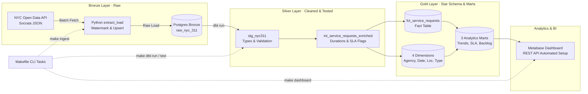

# NYC 311 Data Platform

An end-to-end data platform that ingests live municipal service request data from the NYC 311 Open Data API, transforms it through a Medallion Architecture (Bronze → Silver → Gold) using PostgreSQL and dbt, and visualizes analytical insights in an automated Metabase dashboard.

---

## Architecture & Data Lineage

The platform follows a three-tier **Medallion Architecture**, orchestrated via a unified `Makefile` task runner:



1. **Bronze (`bronze.raw_nyc_311`):** Raw API data landed directly in PostgreSQL with batch audit metadata (`_ingested_at`, `_source_batch_id`) and high-watermark incremental upserts (`ON CONFLICT DO UPDATE`).
2. **Silver (`silver.*`):** Materialized views that clean timestamps, standardize complaint strings, validate borough names, and compute ticket resolution durations.
3. **Gold (`gold.*`):** Physical tables modeled as a dimensional **Star Schema** plus aggregate analytical marts answering specific business questions.
4. **Serving (Metabase):** Containerized BI dashboard automatically provisioned via Metabase's REST API, rendering KPIs, monthly trends, and agency performance charts.

---

## Business Questions Answered

| # | Business Question | Answering Mart / Model | Key Metric |
|---|---|---|---|
| **Q1** | Which complaint types are most common across NYC? | `gold.mart_complaint_trends` | Total request count & monthly rank |
| **Q2** | Which complaint categories are accelerating over time? | `gold.mart_complaint_trends` | Month-over-Month (% MoM) growth rate |
| **Q3** | How quickly do city agencies resolve tickets, and what is their SLA breach rate? | `gold.mart_agency_resolution` | Median and P90 resolution hours, SLA breach % |
| **Q4** | How many requests remain unresolved, and what is their average age? | `gold.mart_open_backlog` | Open request count, average days open by borough |

---

## Data Modeling (Star Schema)

The analytical Gold layer uses an accumulating snapshot Star Schema centered on service requests:

```text
                  dim_date (created & closed)
                            │
  dim_agency ─── fct_service_requests ─── dim_complaint_type
                            │
                       dim_location
```

* **Fact Table (`fct_service_requests`):**
  * **Grain:** One row per service request (`unique_key`).
  * **Keys:** MD5 surrogate keys linking to each dimension (`agency_key`, `date_key`, `location_key`, `complaint_type_key`).
  * **Measures & Flags:** `resolution_time_hours`, `is_closed`, `is_sla_breached`, `has_invalid_close_date`.
  * **Degenerate Dimensions:** `status`, `channel_type`, `resolution_description`.
* **Dimension Tables:**
  * [`dim_agency`](dbt/models/marts/dim_agency.sql): City agencies responding to requests (NYPD, HPD, DSNY, DOT, etc.).
  * [`dim_date`](dbt/models/marts/dim_date.sql): Calendar dimension (year, quarter, month, day of week, weekend flag) covering all request creation and closure dates.
  * [`dim_location`](dbt/models/marts/dim_location.sql): Borough and ZIP code combinations (nulls safely assigned to `UNSPECIFIED`).
  * [`dim_complaint_type`](dbt/models/marts/dim_complaint_type.sql): Granular complaint classification and descriptors.

---

## Key Engineering Decisions & Trade-offs

| Decision | Why Chosen | What Was Avoided |
|---|---|---|
| **NYC 311 Dataset** | Real volume, daily API updates, messy real-world fields (missing dates, dirty boroughs) | Clean or synthetic toy CSVs with no real engineering challenges |
| **Medallion Layers** | Raw copy is preserved in Bronze; transforms can be replayed if business rules change | Single-layer ETL directly into reporting tables with no raw audit trail |
| **Docker for DB & BI** | One-command setup for PostgreSQL 18 and Metabase ensuring identical dev environments | Manual local installs drifting between team members' operating systems |
| **Local dbt Execution** | Instant developer loop (`dbt run`, `dbt test`) and fast IDE linting inside Python virtualenv | Docker rebuild overhead for every single SQL model edit |
| **Upsert on Ingestion** | Timestamp watermarking + `ON CONFLICT DO UPDATE` allows safe, idempotent pipeline re-runs | Truncate-and-reload downtime or duplicate rows from append-only pipelines |

---

## Tech Stack

* **Language & Runtime:** Python 3.12+
* **Data Warehouse:** PostgreSQL 18
* **Data Transformation & Testing:** dbt-core 1.11 (`dbt-postgres`)
* **Business Intelligence:** Metabase v0.63.22
* **Infrastructure:** Docker & Docker Compose
* **Developer CLI:** GNU Make

---

## Quickstart & How to Run

### Prerequisites
* Docker & Docker Compose
* Python 3.12+
* `make`

---

### Step 1: Set Up Python Environment

```bash
# Create and activate virtual environment
python3 -m venv .venv
source .venv/bin/activate

# Install dependencies (dbt, psycopg2, requests)
pip install -r requirements.txt
```

---

### Step 2: Configure Environment Variables

Copy the example environment configuration:

```bash
cp .env.example .env
```

*(The defaults work out of the box for local Docker development).*

---

### Step 3: Start Services

Launch PostgreSQL and Metabase in the background:

```bash
make docker-up
```

Verify that the database is healthy and reachable:

```bash
make dbt-debug
```

---

### Step 4: Ingest Raw Data (Bronze)

Fetch NYC 311 records from the Socrata API and upsert them into `bronze.raw_nyc_311`:

```bash
make ingest
```

---

### Step 5: Run Transformations & Tests (Silver & Gold)

Execute dbt models to build all views, dimensions, facts, and marts:

```bash
make dbt-run
```

Run automated data quality tests (uniqueness, referential integrity, accepted values):

```bash
make dbt-test
```

---

### Step 6: Provision & View the Dashboard

Build the pre-configured **NYC 311 Service Requests** dashboard in Metabase:

```bash
make dashboard
```

Once the script finishes, open **[http://localhost:3000](http://localhost:3000)** in your browser:
* **Email:** `admin@example.com`
* **Password:** `change_me_123`

---

### Step 7: Teardown

When finished, stop all containerized services:

```bash
make docker-down
```

*(To completely remove database and Metabase volumes, run `docker compose down -v`).*

---

## Data Quality & Testing

The project includes **25 automated data tests** validating schema contracts and referential integrity:
* **Primary Key Constraints:** `unique` and `not_null` verified on all dimension surrogate keys and fact `unique_key`.
* **Referential Integrity:** 5 foreign key `relationships` tests verifying that 100% of rows in `fct_service_requests` join cleanly to their respective dimensions.
* **Accepted Values:** Borough names strictly checked against the 5 valid NYC boroughs (`BRONX`, `BROOKLYN`, `MANHATTAN`, `QUEENS`, `STATEN ISLAND`).
* **Source Anomaly Detection:** A custom dbt test ([`assert_closed_not_before_created.sql`](dbt/tests/assert_closed_not_before_created.sql)) monitors upstream dirty records where tickets were marked closed before they were created, automatically flagging them with `has_invalid_close_date = TRUE` and warning without crashing the pipeline.

---

## Project Structure

```text
├── dashboard/
│   └── setup_metabase.py          # Automated REST API provisioning for Metabase
├── dbt/
│   ├── dbt_project.yml            # dbt configuration & schema mapping
│   ├── profiles.yml               # PostgreSQL connection profile
│   ├── macros/
│   │   └── generate_schema_name.sql # Custom schema resolver (bronze/silver/gold)
│   ├── models/
│   │   ├── staging/               # Silver: type casting & cleansing views
│   │   ├── intermediate/          # Silver: duration calculations & SLA flags
│   │   └── marts/                 # Gold: Star Schema fact, dims, and 3 marts
│   └── tests/                     # Custom data quality tests
├── docs/
│   └── architecture.drawio        # draw.io diagram source file
├── extract_load/
│   ├── client.py                  # Socrata API client with pagination
│   ├── db.py                      # PostgreSQL batch upsert loader
│   ├── config.py                  # Ingestion settings & environment parsing
│   └── main.py                    # Ingestion CLI entrypoint
├── infra/
│   └── postgres/
│       ├── 01_schemas.sql         # Auto-provision bronze, silver, gold schemas
│       └── 02_bronze_tables.sql   # Raw landing table DDL
├── tests/                         # Pytest unit tests for ingestion
├── docker-compose.yml             # PostgreSQL 18 & Metabase services
├── Makefile                       # Unified developer CLI task runner
├── requirements.txt               # Pinned Python dependencies
└── README.md
```
